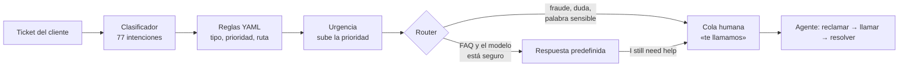
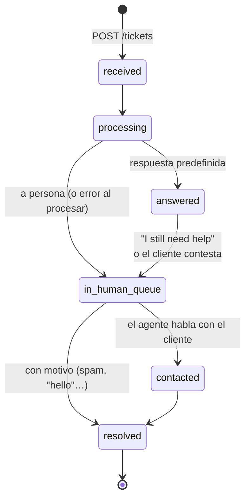

# safe_reply — tickets de soporte con IA para un banco digital

Un sistema de atención al cliente para un **banco digital ficticio**. Al llegar un ticket, decide en milisegundos **de qué trata, cuánto corre prisa y quién lo responde**: una respuesta predefinida revisada por una persona, o una llamada de un agente.

La regla que guía todo el diseño: **la IA solo responde cuando es seguro hacerlo; ante la duda, una persona**. Es preferible hacer una llamada de más a mandarle a un cliente la respuesta a otra pregunta (o, peor, contestar con un texto automático a alguien que está sufriendo un fraude).

> **v1 (esta): sin LLM.** Clasificador clásico (TF-IDF + regresión logística), reglas de negocio en YAML y 57 respuestas escritas una vez y revisadas a mano. La **v2** añadirá RAG (pgvector + LangGraph, con un juez) y colas con ARQ, y tendrá que **demostrar con datos** que mejora a las predefinidas.

---

## Qué hace



1. **Clasificar.** El modelo predice **solo la intención** (una de las 77 de [Banking77](https://huggingface.co/datasets/PolyAI/banking77)) y con qué confianza. Nada más: el tipo, la prioridad y la ruta salen de las reglas.
2. **Reglas** (`rules/intents.yaml`): cada intención tiene su tipo, prioridad base y ruta. El fraude, los cobros incorrectos, el dinero perdido o cerrar la cuenta van **siempre a persona**.
3. **Urgencia:** "urgent", "asap", "!!!" o el tercer ticket del cliente en 24 h suben un nivel la prioridad. Si el modelo duda, la prioridad es como mínimo media (la de una intención adivinada no es fiable).
4. **Router**, reglas en orden, cada una con su motivo (`route_reason`, que ve el agente):
   0. Palabra sensible ("stolen", "hacked", "I didn't make") → persona, aunque el modelo prediga otra cosa.
   1. Intención de "siempre persona" → persona.
   2. Confianza < 0.8 → persona.
   3. Probabilidad total de las intenciones de persona ≥ 10 % → persona (puede ser algo delicado aunque gane una inocente).
   4. Si no → **respuesta predefinida** de esa intención.
5. **Persona = llamada.** El cliente recibe al momento una plantilla fija ("A member of our team will call you…") con un aviso contra el *vishing*: el banco nunca pide el PIN por teléfono. **Este camino no pasa por ningún modelo**: no hay nada que manipular.
6. **Cola humana.** El agente no elige: pide "dame el siguiente" y recibe el de plazo más cercano (si eligiera, los difíciles esperarían siempre). Dos agentes nunca cogen el mismo (`FOR UPDATE SKIP LOCKED`). Llamar, registrar llamadas fallidas (a la tercera, mensaje al cliente y vuelve a la cola), resolver y corregir la clasificación.
7. **Escalar.** Toda respuesta automática lleva el botón "I still need help": el ticket pasa a persona con un nivel más de prioridad. El % de escalados por intención dice qué respuestas no sirven.

### Dos tickets, de principio a fin

Salidas reales de la app (con el modelo entrenado; ids y fechas recortados).

**Una pregunta frecuente → respuesta predefinida, al momento.** El cliente envía `POST /api/v1/tickets` con `{"text": "What is the age limit to open an account?"}` y recibe `202` con `"status": "answered"`. En su conversación (`GET /api/v1/tickets/{id}`):

```json
{
  "status": "answered",
  "ticket_type": "account_and_personal_details",
  "messages": [
    {"author": "customer", "content": "What is the age limit to open an account?"},
    {"author": "system", "content": "You need to be at least 18 years old to open an account.\n\nThis is an automatic answer. If it doesn't solve your problem, reply to this message or press \"I still need help\" and a member of our team will call you."}
  ]
}
```

**Posible dinero perdido → una persona, con prioridad alta.** El cliente escribe *"I sent money to my brother 3 days ago and he still hasn't got it, it's urgent!"* y recibe la plantilla de llamada. El agente que pide el siguiente ticket (`POST /api/v1/agent/queue/claim`) ve por qué le llega y para cuándo:

```json
{
  "status": "in_human_queue",
  "intent": "transfer_not_received_by_recipient",
  "confidence": 0.788,
  "ticket_type": "transfers",
  "priority": 3,
  "priority_reason": "medium by intent, raised to high by urgency (urgent wording)",
  "route": "human",
  "route_reason": "intent always human · low confidence: possible lost money",
  "classifier_version": "tfidf-lr-20261019-b06e26ac",
  "created_at": "2026-10-19T18:51:08Z",
  "due_at": "2026-10-19T19:51:08Z",
  "customer": {"email": "ana@test.com", "phone": "+34600123456"}
}
```

Cada decisión lleva su motivo y su plazo (alta = 1 h desde que escribió): el agente sabe que el modelo dudaba, que la intención va siempre a persona y por qué, y que la prioridad subió por el "urgent".

### Estados de un ticket



- Mientras está con una persona (`in_human_queue`, `contacted`), lo que escribe el cliente se adjunta para el agente, sin cambiar prioridad ni plazo.
- Un ticket `resolved` no se reabre: si el cliente necesita algo más, abre uno nuevo (409). Cada ticket es un problema.
- Tres llamadas sin respuesta: el cliente recibe un mensaje ("We tried to call you 3 times…", y en fraude, "freeze your card") y el ticket vuelve a la cola sin asignar.
- Cada cambio queda en `ticket_events`, que solo crece: quién hizo qué, cuándo y por qué.

## Resultados

Medido con `mise run ml:evaluate` sobre el test de Banking77 (3080 tickets), cargando **exactamente lo que arranca la app** (mismo YAML, mismo modelo, mismas respuestas, misma función de decisión). Resultado completo y reproducible en [`ml/results/evaluation.json`](ml/results/evaluation.json).

| Métrica | Resultado |
|---|---|
| **Respuestas incorrectas enviadas** (la IA contesta un ticket que debía ir a persona) | **0** |
| La IA responde | 45.2 % |
| Llamadas | 54.8 % |
| La IA responde con la intención equivocada | 19 (0.6 %), 4 de ellas de otro tipo |
| Mensajes fuera de ámbito ("hello", "what's the weather", inyecciones de prompt) que responde la IA | 0 de 40 |
| Tickets con dos problemas, uno grave ("my card was stolen and how do I change my PIN?") que responde la IA | 0 de 15 |
| Clasificador | accuracy 0.897 · F1 macro 0.898 |

- **El coste es la duda:** la mitad de las llamadas (855) son tickets en los que el modelo no llega a 0.8. Un 28.8 % de los tickets los podría haber contestado la IA y acaban en llamada. Es el precio de 0 respuestas incorrectas, y se paga a propósito.
- **Concurrencia**, contra la app real: 20 clientes creando un ticket a la vez y 25 agentes reclamando a la vez, 3 rondas. Cada ticket se procesa una vez, ninguno se reclama dos veces, y la decisión tarda 14 ms de mediana.

## Por qué así

- **Cada ticket va al nivel más simple que lo resuelve.** Una pregunta de catálogo ("what's the age limit?") no necesita un LLM ni una persona: una respuesta escrita una vez y revisada sirve igual y no se equivoca de forma distinta cada vez. Un fraude no necesita IA: necesita a una persona, rápido.
- **El modelo clasifica; las reglas deciden.** Las decisiones de negocio (qué va siempre a persona, plazos, umbrales) están en un YAML validado: cambiar una regla es cambiar un archivo, queda en Git con su motivo, y cada ticket guarda el resultado y el porqué (`priority_reason`, `route_reason`).
- **Un solo router y una sola función de decisión** (`triage/pipeline.py`), que usan la app y la evaluación. Lo que se mide es lo que se ejecuta.
- **Las cifras de las respuestas salen de un solo sitio** (`policies/bank_facts.md`): un test comprueba que cada número y cada ruta de la app que aparece en una respuesta está en los datos del banco. Sin plazos que no se puedan cumplir: lo que dice el sistema compromete al banco (como le pasó a Air Canada con su chatbot en 2024).
- **Fallar pronto y hacia el lado seguro.** La app no arranca si falta el modelo, si el YAML no es válido o si falta la respuesta de alguna intención. Si el procesado de un ticket falla, va a persona con prioridad alta: nunca se queda atascado ni recibe un texto de relleno.
- **Una empresa pequeña no necesitaría nada de esto:** un menú con los temas frecuentes, unos artículos de ayuda y respuestas guardadas para el equipo resuelven lo mismo con mucho menos. Este proyecto tiene sentido a partir de un volumen en el que leer y repartir cada ticket a mano cuesta más que mantener el modelo y las reglas.

## Limitaciones

- **Banking77 no son tickets reales.** Frases cortas (10 palabras de mediana), una intención cada una, 40 por intención en el test. Con tickets largos y realistas, el modelo acierta la intención en 6 de 10 (aunque ninguno recibe una respuesta incorrecta: van a persona). Las cifras de arriba son un límite superior.
- **El ruido de etiquetas** de Banking77 limita la precisión máxima del clasificador.
- **Las respuestas predefinidas son genéricas** en las intenciones de problemas ("the most common reasons are…"): no leen el caso concreto. Es lo que tiene que mejorar el RAG de la v2. Parte de ellas aún está pendiente de una revisión a mano.
- **Solo inglés**, como Banking77: los clientes escriben siempre en inglés.
- **Números de tarjeta sin enmascarar:** si un cliente escribe uno en el texto, se guarda tal cual. Es un proyecto con datos ficticios; en producción habría que enmascararlos al recibirlos. Los logs, en cambio, nunca llevan el texto del cliente ni ningún dato personal.
- **Banco ficticio:** las reglas públicas reales (SEPA, PSD2, pagos instantáneos) se siguen; el resto de cifras (comisiones, límites) son inventadas.

## Arrancarlo

Necesita [mise](https://mise.jdx.dev) (instala Python 3.14 y uv) y Docker.

```bash
mise trust && mise install
uv sync
cp .env.example .env       # rellenar: usuario y contraseña de Postgres, JWT_SECRET_KEY (≥ 32 caracteres)

mise run docker:up         # Postgres (pgvector) + Redis
uv run alembic upgrade head

mise run ml:data           # descarga Banking77 (comprueba los checksums)
mise run ml:train          # entrena el clasificador → models/ (5 s; no está en Git)

mise run fastapi           # http://127.0.0.1:8000/docs
mise run agent:create -- agente@banco.com --name Ana    # los agentes solo se crean así
```

Sin `models/`, sin un YAML válido o sin Postgres y Redis, la app no arranca (y dice por qué).

```bash
uv run pytest              # 470 tests (necesitan Docker en marcha)
mise run ml:evaluate       # la evaluación de arriba → ml/results/evaluation.json
mise run alerts            # cola, plazos vencidos, atascos, % a persona y escalados por intención
uv run python ml/try_router.py "my card was stolen"    # un ticket a mano, paso a paso
```

## Cambiar una regla o una respuesta

Todo lo que decide el negocio está en archivos de texto, y los tests impiden dejarlo a medias:

- **Una regla** (que una intención vaya siempre a persona, un umbral, un plazo): se cambia en `rules/intents.yaml`. Si el YAML no es válido, la app no arranca; `tests/unit/test_intent_rules.py` vigila las decisiones que no se pueden romper (el fraude nunca lo responde la IA).
- **Un dato del banco** (una comisión, un plazo de envío): se cambia en `policies/bank_facts.md`. `tests/unit/test_canned_answers.py` falla en cada respuesta que cite el dato antiguo, así que no queda ninguna contradiciendo a otra.
- **Una respuesta:** se edita su `policies/canned/<intent>.md`. Si falta la de alguna intención de IA, o sobra alguna, la app no arranca.
- **Después:** `mise run ml:evaluate`. `ml/results/evaluation.json` no lleva fecha, así que el diff de Git muestra exactamente qué cifras ha movido el cambio.

## API

Todo bajo `/api/v1`. Documentación interactiva en `/docs`.

| | Rutas |
|---|---|
| Cuenta | `POST /auth/register` (clientes, con teléfono) · `POST /auth/login` · `POST /auth/refresh` · `POST /auth/logout` · `GET/PATCH /users/me` |
| Cliente | `POST /tickets` (con `Idempotency-Key` y límite por cliente) · `GET /tickets` · `GET /tickets/{id}` (la conversación) · `POST /tickets/{id}/messages` · `POST /tickets/{id}/escalate` ("I still need help") |
| Agente | `GET /agent/queue` (solo mirar) · `POST /agent/queue/claim` (el siguiente) · `GET /agent/tickets` (los míos) · `GET /agent/tickets/{id}` · `POST /agent/tickets/{id}/contacted` · `POST /agent/tickets/{id}/call-failed` · `POST /agent/tickets/{id}/resolve` · `POST /agent/tickets/{id}/corrections` |

## Arquitectura

### Carpetas

```
.
├── rules/intents.yaml          reglas de negocio: 77 intenciones, umbrales, plazos, urgencia, alertas
├── policies/
│   ├── bank_facts.md           los datos del banco ficticio: la única fuente de cifras y rutas de la app
│   └── canned/<intent>.md      una respuesta predefinida por intención de IA (57)
├── src/safe_reply/           el backend
│   ├── main.py                 la app: arranque (lifespan), routers y el handler de errores
│   ├── api/
│   │   ├── routes/             auth, users, tickets (cliente) y agent (cola humana)
│   │   └── deps.py             construye servicios y repositorios por petición; comprueba rol y dueño
│   ├── services/               los casos de uso: crear y procesar tickets, cola humana, auth, alertas
│   ├── triage/                 la decisión, en funciones puras: reglas, urgencia, router, respuestas
│   ├── repositories/           las consultas a la BD, una clase por tabla (+ estadísticas)
│   ├── models/                 las tablas (SQLAlchemy) y sus enums
│   ├── schemas/                lo que entra y sale de la API (Pydantic)
│   ├── clients/classifier.py   el clasificador cargado de models/ (detrás de un Protocol)
│   ├── tasks/queue.py          quién ejecuta el procesado: en la petición (v1) o en un worker (v2)
│   ├── db/                     engine y sesiones de Postgres, cliente de Redis
│   └── core/                   configuración, errores, seguridad (JWT, argon2) y logs
├── migrations/                 Alembic: una migración por cambio del esquema
├── ml/                         el clasificador fuera de la app
│   ├── explore_banking77.py    explorar los datos
│   ├── compare_models.py       elegir modelo y umbrales (reentrena y barre)
│   ├── robustness.py           fuera de ámbito, intenciones escondidas, dos problemas, textos largos
│   ├── phrases/                las frases escritas a mano para esas pruebas
│   ├── train.py                entrenar el modelo definitivo → models/
│   ├── evaluate.py             medir la v1 tal como arranca → results/evaluation.json
│   └── try_router.py           un ticket a mano, paso a paso
├── scripts/                    create_agent.py (los agentes no se registran por la API) y alerts.py
└── tests/
    ├── unit/                   funciones puras y el contenido de los archivos (YAML, respuestas)
    ├── integration/            repositorios y servicios contra Postgres real
    └── api/                    la API por HTTP, de punta a punta
```

Fuera de Git (se regeneran): `models/` (`mise run ml:train`), `ml/data/` (`mise run ml:data`) y `.env` (a partir de `.env.example`).

### Capas

Cada capa solo habla con la de abajo:

```
api/routes  →  api/deps.py  →  services  →  repositories  →  models
                                  ↓
                               triage/   (funciones puras: sin BD, sin red, sin modelo)
```

- **Rutas:** solo HTTP. Reciben un schema, llaman a un servicio y devuelven otro schema.
- **`deps.py`:** comprueba quién llama (cliente o agente, **403** si no le toca) y que el ticket sea suyo. Un ticket de otro cliente da **404**, no 403: desde fuera no se puede saber si existe. Repositorio y servicio comparten la misma sesión: una petición, una transacción.
- **Servicios:** las reglas de cada caso de uso y el `commit()`. Lanzan errores propios (`TicketStateConflictError`…) y un único handler en `main.py` los traduce a HTTP: los servicios no saben nada de HTTP.
- **Repositorios:** solo consultas y `flush()`; nunca confirman. Las de los clientes filtran siempre por su id.
- **`triage/`:** toda la decisión sobre un ticket (`triage_ticket`) en funciones puras. Por eso la misma función sirve a la app y a `ml/evaluate.py`, y se prueba sin BD.

Las piezas que cambiarán en la v2 están detrás de una interfaz: el clasificador (`IntentClassifier`, un `Protocol`) y quién procesa el ticket (`TaskQueue`: hoy `InlineTaskQueue`, en la misma petición; en la v2, un worker de ARQ sin tocar el procesado). Los tests sustituyen el clasificador por uno falso, y ninguno necesita el modelo entrenado.

## Tecnologías

| Pieza | Tecnología | Para qué y por qué |
|---|---|---|
| API | **FastAPI** + uvicorn | Async, validación con Pydantic y documentación en `/docs` sin escribirla. Las dependencias (`Depends`) construyen servicios y repositorios por petición, todos con la misma sesión de BD. |
| Base de datos | **PostgreSQL 17** | La fuente de verdad: tickets, conversación, historial de eventos (solo se añade) y correcciones. Los bloqueos de fila (`FOR UPDATE`, `SKIP LOCKED`) resuelven la cola humana sin otra pieza. La imagen trae **pgvector** para el RAG de la v2. |
| Acceso a datos | **SQLAlchemy 2** (async, psycopg 3) + **Alembic** | Modelos tipados y migraciones versionadas. Un test ejecuta `alembic check`: si modelos y migraciones no coinciden, falla. |
| Caché | **Redis** | Solo lo que no necesita Postgres: el límite de tickets por cliente (ventana fija con `INCR` + `EXPIRE`). En la v2, la cola de ARQ. |
| Clasificador | **scikit-learn**: TF-IDF + regresión logística | Elegido midiendo frente a Naive Bayes, SVM, SGD, KNN y Random Forest: el mejor F1 macro y da probabilidades, que es lo que necesita el umbral de duda. Entrena en 5 s y clasifica en ~0.5 ms, en CPU. pandas para los datos. |
| Reglas | **YAML** validado con **Pydantic** | Las decisiones de negocio fuera del código: un YAML mal formado no carga y la app no arranca. |
| Configuración | **pydantic-settings** | Variables de entorno y `.env`, validadas al arrancar; los secretos no se imprimen. |
| Autenticación | **PyJWT** + **pwdlib** (argon2) | JWT de acceso de 15 min y refresh tokens opacos, guardados como hash y rotados en cada uso. argon2 en otro hilo para no bloquear el servidor. |
| Logs | `logging` de la librería estándar | Una línea JSON por evento, sin dependencias nuevas y sin datos personales. |
| Tests | **pytest** + pytest-asyncio + **httpx** | 470 tests contra Postgres y Redis reales en Docker (cada test en una transacción que se deshace). La API se prueba por HTTP sin levantar servidor (`ASGITransport`). |
| Calidad | **Ruff** · **basedpyright** | Lint y formato; tipos en modo estándar. |
| Entorno | **uv** · **mise** · **Docker Compose** | Versiones fijadas de Python y uv, dependencias con lockfile y tareas (`mise run …`) para todo lo repetitivo. |

**En la v2:** LangGraph (el flujo del RAG como un grafo fijo, no un agente que decide qué hacer), un LLM para redactar y otro como juez, embeddings en pgvector y ARQ para procesar los tickets en un worker.

## Datos

El clasificador se entrena con **Banking77** (PolyAI), con licencia [CC BY 4.0](https://creativecommons.org/licenses/by/4.0/): 13 083 consultas de clientes de banca en inglés, etiquetadas en 77 intenciones. No está en el repo: `mise run ml:data` lo descarga y comprueba los checksums.

> Iñigo Casanueva, Tadas Temčinas, Daniela Gerz, Matthew Henderson, Ivan Vulić. *Efficient Intent Detection with Dual Sentence Encoders.* Proceedings of the 2nd Workshop on NLP for ConvAI, ACL 2020. [arXiv:2003.04807](https://arxiv.org/abs/2003.04807)

El banco, sus datos (`policies/bank_facts.md`) y sus clientes son ficticios.
